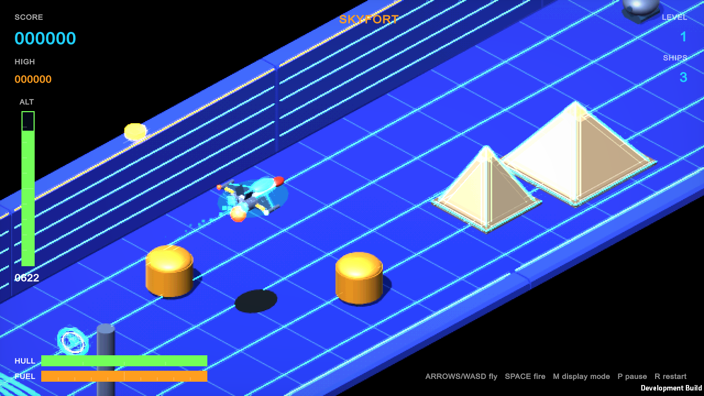
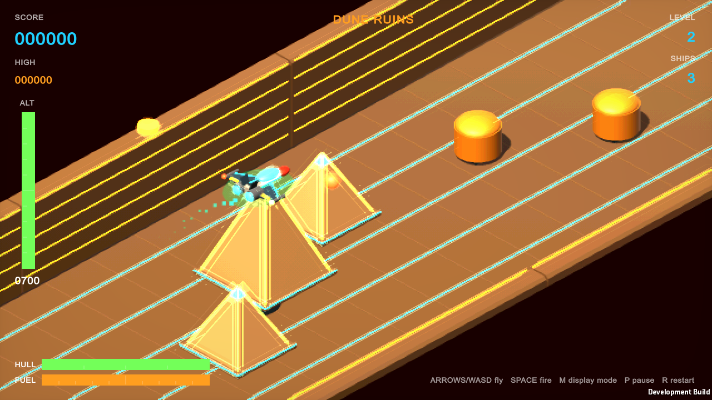
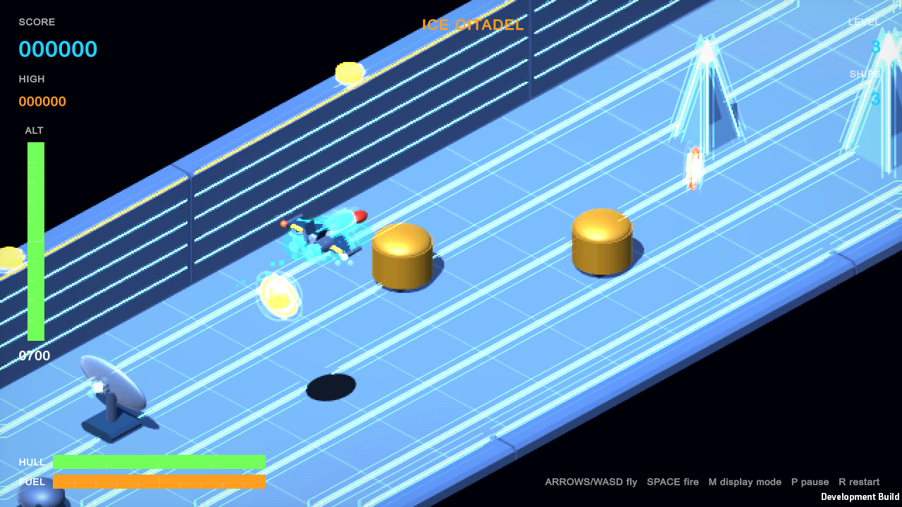
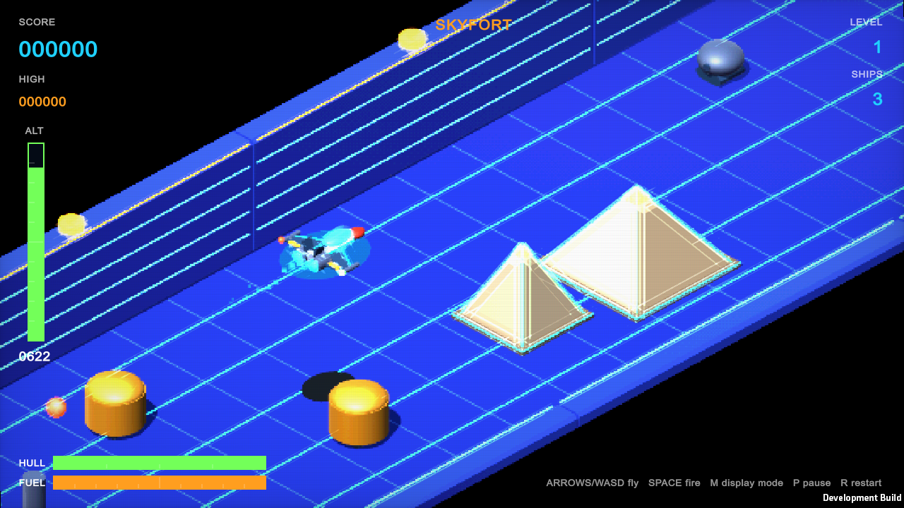
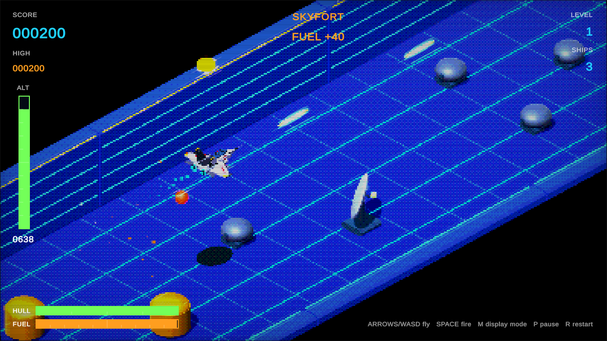
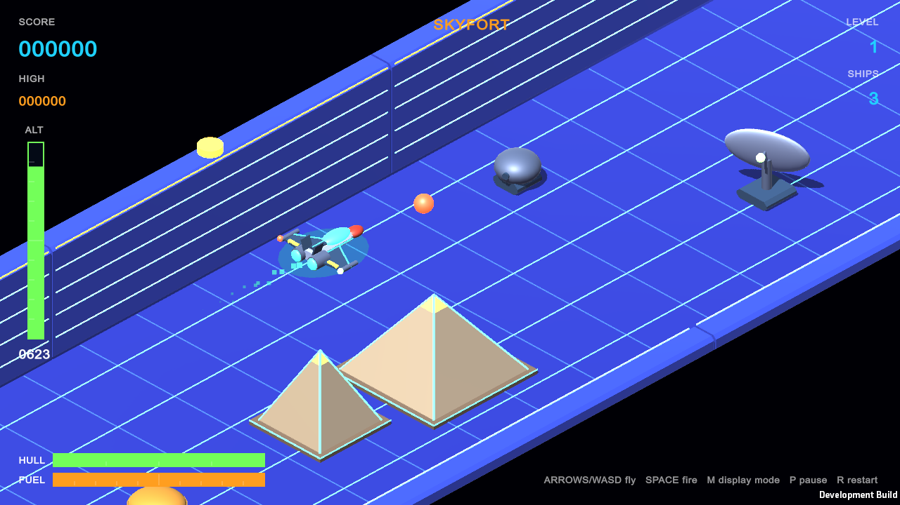

# Skyfort Strike — Unity 6 Feature Showcase

**Play it in your browser:** https://jcallinan.github.io/Unity6VideoGames/

An isometric, forward-scrolling altitude shooter. Your strike fighter flies itself down a corridor; you steer, climb and dive around pyramids, castles, obelisks, ice spires and force fields, and you shoot ground targets at their own height. Grab power-ups, keep your fuel up, survive the mid-level drone wave, and take on the Warden, a towering guardian mech, at the end of every level.

There are seven levels, each with its own look and obstacle mix. After the seventh, they repeat, a little faster each time:

| Level | Theme | Obstacles | Mid-level zone |
|---|---|---|---|
| 1 | **Skyfort**: a floating fortress in deep space | Pyramids, castle walls and keeps, force fields | Open Space |
| 2 | **Dune Ruins**: sandstone ruins under a burning sky | Pyramid fields, obelisk needles, sandstone forts | Sandstorm Flats |
| 3 | **Ice Citadel**: a frozen fortress on a dark night | Crystal ice spires, ice castles, force fields | Aurora Field |
| 4 | **Violet Bastion**: striped violet decks, orange crystal pyramids | Pyramids, force fields, radar sites | Galaxy Drift |
| 5 | **Azure Causeway**: a royal-blue road lined with golden pillars | Gold obelisks, castle walls and keeps | Comet Lane |
| 6 | **Brick Bulwark**: grey brick ramparts on an electric-cyan floor | Brick walls, keeps and bastions | Scrapyard Orbit |
| 7 | **Refinery**: an industrial plain of banded fuel tanks | Fuel tanks, stacks, castle walls, force fields | Asteroid Belt |

| Skyfort | Dune Ruins | Ice Citadel |
|---|---|---|
|  |  |  |

Levels 2 and 3 include a **cockpit run**: in the second half the camera blends from the isometric view into a first-person view from the ship's nose, with a green reticle, then blends back out.

## Open and play

1. Open this folder in Unity Editor **6000.3 or later**.
2. Open `Assets/Scenes/SkyfortStrike.unity` and press **Play**.

| Action | Keys |
|---|---|
| Steer left / right | **A / D** or **← / →** |
| Climb / dive | **W / S** or **↑ / ↓** |
| Fire | **Space** (also **J**, **Z**, **Left Ctrl**) |
| Display mode | **M** cycles 16-BIT → CRT → ARCADE → ATARI → MONO LCD → MODERN |
| Pause | **P** or **Esc** |
| Restart | **R**, or **Space / Enter** on the Game Over screen |

### Retro look, neon and display modes

The game aims for a look between an early-80s arcade isometric shooter and a 16-bit console: saturated decks on black sky, hard shadows, and neon everywhere. Neon traces the deck grid, pyramid and spire edges, castle walls and towers. The fighter has neon wing edges, fuselage strips, nozzle rings, a soft underglow and a cyan-to-green engine trail. Each level has its own neon pair (`Neon` / `NeonAlt` in `SkyfortThemes.cs`).

A display filter on the camera (`SkyfortRetroFilter` with `Assets/Shaders/SkyfortRetro.shader`) gives the pixel-art look. Press **M** to switch modes (it's kept away from the WASD flight keys); your choice is remembered.

| Mode | What it does |
|---|---|
| **16-BIT** (default) | A 360-line pixel grid with lightly softened edges, 15-bit color and a neon glow |
| **CRT** | A curved picture tube: clearly visible scanlines, an RGB mask, color fringing, heavy glow and vignette |
| **ARCADE** | Chunky 224-line pixels, 512 colors with dither, deep scanlines and punchy saturation |
| **ATARI** | 2600-style: 320 x 240 pixels, limited flat colors, lightly streaked rows with dark gaps between scanlines, no glow |
| **MONO LCD** | Four-shade green handheld-LCD look on a 144-line grid |
| **MODERN** | No filter: full-resolution rendering |

The same stretch of the Skyfort level in each mode:

| 16-BIT (default) | CRT |
|---|---|
|  |  |
| **ARCADE** | **MODERN** |
|  |  |

The modes keep edges crisp with just a touch of softness, and only neon-bright light blooms. The HUD is drawn by UI Toolkit on top of the filtered image, so it stays sharp in every mode.

### How to fly

- **Read your height.** The ALT gauge (left), the ship's ground shadow (it shrinks as you climb) and the glowing rungs on the far rampart all show your altitude.
- **Pyramids and castles** fill the fortress: pyramid fields and rows, curtain walls with towers, and keeps with a turret on the roof. Fly over or around them. Everything tops out below the ship's ceiling, so climbing high always clears it.
- **Force fields** (pink beams) rise from the floor. Fly over them.
- **Bumping into things doesn't cost a ship.** Hit any obstacle or ground target and the fighter bounces off and up, losing ground instead.
- **Your hull takes four hits.** Each enemy shot knocks off a quarter of the HULL gauge and gives you a moment of invulnerability (the ship blinks). At one point left, the ship trails sparks. Only an empty hull, or running out of fuel, costs a ship. A new ship starts with a full hull.
- **Your laser fires at your current altitude.** Dive low to hit turrets (150), fuel tanks (300, refuels you) and radar dishes (1000, two hits).
- **Fuel** burns constantly, except in the Warden arena. When it runs out, you crash.

### Power-ups

Fly through a spinning halo to collect it (+100 points each). They float in the corridor, and destroyed targets sometimes drop one; radar dishes always do. Repairs turn up more often when your hull is damaged.

| Power-up | Halo | Effect |
|---|---|---|
| **Repair** | White cross on a red halo | Restores 2 hull points |
| **Fuel** | Gold canister | +40 fuel |
| **Shield** | Cyan orb | A bubble absorbs all enemy fire for 10 seconds (it flickers when it's about to expire) |
| **Spread Shot** | Green shards | Three-way lasers and faster firing for 15 seconds |
| **Extra Ship** | White chevron (rare) | +1 ship, up to 9 |

Active timers show above the HULL gauge, and a notice appears under the level name when you collect something or take a hit.
- **The Warden.** Hit its glowing red eye before it withdraws, and dodge its plasma spreads. Destroying it awards 5000 × level.

## Project layout

The scene is laid out ahead of time, so you can explore it in the Hierarchy and Scene view:

| Scene object | What it is |
|---|---|
| **Skyfort Strike** | The game (`SkyfortStrike` component). Its Inspector lists every scene object and prefab it uses. The **Audio** child holds the SFX and engine-loop sources. |
| **Isometric Camera** | Orthographic camera at the game's framing. At runtime it follows the ship along the corridor. |
| **Key Light** / **Explosion Flash** | Directional light with soft shadows (its color and strength ease to each level theme), and the point light that flares on explosions. |
| **Strike Fighter** | The player ship (`Rigidbody`), with its model, engine trail and the hidden **Shield Bubble**. **Ground Shadow** is the altitude cue drawn straight below it. |
| **The Warden** | The boss, standing where it fights. It's hidden when the game starts and appears at the end of each level. |
| **Explosion FX** | One world-space particle system that every explosion bursts into. |
| **HUD** | A UI Toolkit `UIDocument` using `Assets/UI/SkyfortPanelSettings.asset`. `SkyfortHud` builds and data-binds its elements at startup. |
| **Level (streamed at runtime)** | Empty in the editor. The corridor is generated here chunk by chunk as you fly: deck, pyramids, castles, force fields and targets. |
| **Projectile Pools (filled at runtime)** | The pooled lasers and enemy bolts, created with `InstantiateAsync`. |

Spawned objects are prefabs in `Assets/Prefabs`: Turret, Fuel Tank, Radar Dish, Drone, Laser, Enemy Bolt and the five PowerUp prefabs. Their procedural meshes and materials are saved in `Assets/Art`. Level themes (colors, sky, light) are defined in `Assets/Scripts/SkyfortThemes.cs`; hull damage and power-ups live in `SkyfortStrike.PowerUps.cs`.

The camera, lights, fighter, Warden, effects and HUD are ordinary GameObjects saved in `Assets/Scenes/SkyfortStrike.unity`, and the enemies, projectiles and power-ups are prefabs in `Assets/Prefabs`, so edit them directly in the Editor. Their meshes and materials are saved in `Assets/Art`. All models are original low-poly meshes. Level chunks are built at runtime from a small model kit (`SkyfortModels`), cloning the two Standard materials in `Assets/Resources` so the shader and its emission variant ship in player builds.

## Unity 6 features used

| Feature | Where |
|---|---|
| **UI Toolkit runtime data binding**: `[CreateProperty]`, `DataBinding`, `INotifyBindablePropertyChanged`, `IDataSourceViewHashProvider` | `SkyfortHud.cs`: the HUD is bound to `SkyfortHudState` and updates only when values change |
| **Binding converters** (`ConverterGroup` / `sourceToUiConverters`) | bool → `style.display` (boss bar), bool → `style.color` (low fuel and hull warnings) and `Color` → `style.color` (pickup and damage notices) |
| **`[UxmlElement]` / `[UxmlAttribute]` custom controls** (source-generated) | `SkyfortGauge`, drawn with the `Painter2D` vector API |
| **`Awaitable.BackgroundThreadAsync` / `MainThreadAsync`** | `SkyfortAudio.LoadAsync` synthesizes every sound on a worker thread, then returns to the main thread to create the `AudioClip`s |
| **`Awaitable<T>`, `WaitForSecondsAsync`, `destroyCancellationToken`** | Countdown, respawn, boss death sequence and banners; all cancel safely when the object is destroyed |
| **`Object.InstantiateAsync`** | Batched asynchronous prewarm of the laser and enemy-bolt pools |
| **`Rigidbody.linearVelocity`** | Fighter movement |
| `FindAnyObjectByType`-era APIs, `RenderSettings`, GPU-instanced runtime materials | World setup |

## Sound

All sound effects and the engine drone are synthesized in code by `SkyfortAudio` (lasers, enemy shots, explosions, fuel and radar chimes, low-fuel alarm, boss siren and hits, fanfares), so no audio files are needed.

## WebGL build and GitHub Pages

Build locally and publish from the `docs` folder on `main`:

1. Install Unity **6000.3.x** with the **WebGL Build Support** module.
2. Open the project and choose **Build → WebGL to docs (GitHub Pages)**. This disables compression (GitHub Pages can't serve Unity's compressed builds) and writes the build to `docs/`.
3. Commit and push the `docs` folder to `main`.
4. In **Settings → Pages**, set **Source** to **Deploy from a branch**, then choose `main` and `/docs`.

The site is served at [https://jcallinan.github.io/Unity6VideoGames/](https://jcallinan.github.io/Unity6VideoGames/).

The `Build and deploy WebGL` workflow is an optional, manual-only alternative that builds in CI with GameCI. It needs the `UNITY_LICENSE`, `UNITY_EMAIL`, and `UNITY_PASSWORD` repository secrets (see the [GameCI activation guide](https://game.ci/docs/github/activation/)) and a Pages source of **GitHub Actions**. Never commit a license file, password, or secret.
